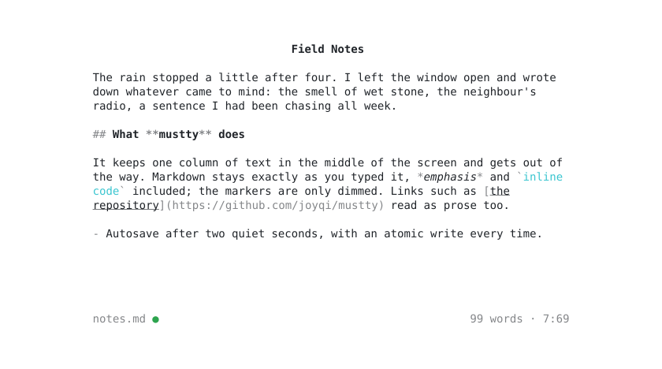

<p align="center"><picture><source media="(prefers-color-scheme: dark)" srcset="assets/logo-dark.svg"></picture></p>

<h1 align="center">mustty</h1>

<p align="center">An old-fashioned Markdown writer for the terminal</p>

<p align="center">
  <a href="https://github.com/joyqi/mustty/actions/workflows/ci.yml"></a>
  <a href="LICENSE"></a>
  
</p>

mustty is an unhurried place to write by hand, one word at a time, inside the terminal. It opens a single Markdown file on a centered 72-column sheet with nothing on screen but the title, the body, and a one-line status bar. Syntax markers stay visible but dimmed, so you always edit the source in front of you.

<p align="center"><picture><source media="(prefers-color-scheme: dark)" srcset="assets/screenshot-dark.svg"></picture></p>

## Why mustty

- One file at a time on a 72-column centered page (40–120), with no file tree, splits, borders, or chrome.
- Markdown headings, emphasis, code, links, lists, and quotes are styled in place while their `#`, `*`, and `` ` `` markers dim instead of disappearing.
- Lists continue themselves: `Enter` starts the next bullet, checkbox or number, `Tab` / `Shift+Tab` nest and un-nest items, and numbered lists renumber as you edit.
- Autosave writes atomically after 2 seconds of idle time, on focus loss, and on quit, and pauses if another program modifies the file on disk.
- Soft wrapping follows Unicode line-breaking rules (UAX #14), so mixed English and CJK text wraps cleanly and closing punctuation never starts a line.
- Positioning the terminal's hardware cursor—rather than drawing a fake one—keeps IME candidate windows attached to the character you are typing.
- The terminal window title follows the document title (or its file name) as you type, with a leading `*` while there are unsaved changes.
- `Ctrl+F` finds text as you type and highlights every match; `Ctrl+N` / `Ctrl+B` step to the next / previous one, and `Esc` takes you back to where you were. Lowercase queries ignore case.
- Typewriter mode (`Ctrl+T`), Focus mode (`Ctrl+O`), optional vim keys, optional mouse support, OSC 52 clipboard over SSH, and an English / Simplified Chinese UI.

## Install

macOS and Linux:

```sh
curl -LsSf https://github.com/joyqi/mustty/releases/latest/download/mustty-installer.sh | sh
```

Windows (PowerShell):

```powershell
irm https://github.com/joyqi/mustty/releases/latest/download/mustty-installer.ps1 | iex
```

Homebrew on macOS or Linux:

```sh
brew install joyqi/tap/mustty
```

From source with Rust 1.88 or newer:

```sh
cargo install --git https://github.com/joyqi/mustty
```

Or grab an archive from [Releases](https://github.com/joyqi/mustty/releases).

Or try it in your browser at [mustty.com](https://mustty.com) — the editor runs there as WebAssembly.

## Usage

```text
mustty [FILE]
```

Pass a file to open or create it on first save, or omit `FILE` to start an Untitled document (`-h` / `--help` and `-V` / `--version` are the only flags).

- Press `Ctrl+G` inside the app (or `?` in vim Normal mode) to see the shortcuts worth knowing.
- Press `Ctrl+D` to check or uncheck the task box on the cursor's line; on a line without one it makes the line a `- [ ] ` task. Checked items are dimmed.
- Press `Ctrl+L` (or `gx` / `Enter` in vim Normal mode) to open the link under the cursor in your browser; only `http(s)://` and `www.` addresses open.
- Press `Ctrl+P` to open the live settings panel. Changes apply immediately and write back to `~/.mustty.toml` (`width`, `vim`, `mouse`, `autosave`, `autosave_idle_ms`, `typewriter`, `focus_mode`, `scrolloff`, `tab_width`, `code_color`, `code_highlight`, `link_color`, `rule_lines`, `cursor`, `cursor_blink`, `lang`).
  `code_highlight` (on by default) colors code blocks whose fence names a language (` ```rust `, ` ```py `, ` ```diff `, 30 languages): keywords bold, strings green, comments dim, diff lines green and red. Off, code blocks are one color, `code_color`.
  `link_color` (`none` by default, or one of the 8 `code_color` names) colors link text and plain `http(s)://` / `www.` URLs, which are underlined either way. `rule_lines` (off by default) draws `---`, `***` and `___` as a line across the text column, showing the characters again while the cursor, the selection or a find match is on it.
  `cursor` is `bar`, `block`, or `underline`, previewed live in the panel; with vim on, `cursor` and `cursor_blink` only affect Insert mode (Normal and Visual always use a block).

## License

[MIT](LICENSE)
