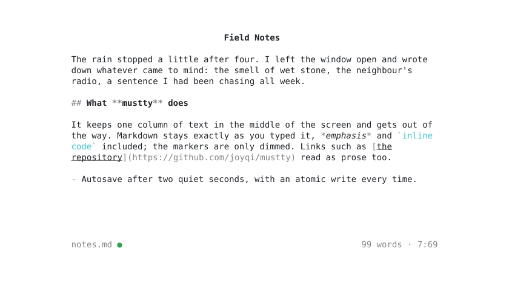

<p align="center"><picture><source media="(prefers-color-scheme: dark)" srcset="assets/logo-dark.svg"></picture></p>

<h1 align="center">mustty</h1>

<p align="center">A distraction-free Markdown writer for the terminal</p>

<p align="center">
  <a href="https://github.com/joyqi/mustty/actions/workflows/ci.yml"></a>
  <a href="LICENSE"></a>
  
</p>

mustty opens one Markdown file and gives you a quiet place to write it. The screen has three parts: a title, a 72-column body centered in the terminal, and a one-line status bar. Markdown syntax stays visible but dimmed, so you always see the source you are editing, in the spirit of iA Writer. Saves are atomic, and long lines of mixed English and CJK text wrap where they should.

<p align="center"><picture><source media="(prefers-color-scheme: dark)" srcset="assets/screenshot-dark.svg"></picture></p>

<p align="center"><sub>A real frame rendered by mustty. After changing the UI, regenerate it with <code>cargo run --example screenshot</code>.</sub></p>

## Features

- **One centered column.** The body is 72 columns wide by default (40–120), centered horizontally; no borders, panels or background colors.
- **Dimmed, not hidden, Markdown.** Headings, emphasis, code, links, lists and quotes are styled while their markers stay on screen.
- **Title from the first heading.** The title line edits the document's leading `# ` heading; an untitled document shows the file name as a placeholder.
- **Saving you can stop thinking about.** Autosave after 2 seconds of idle time, when the terminal loses focus and on quit. Writes go through a temporary file and an atomic rename, and BOM, CRLF line endings and the trailing newline are preserved.
- **Save state at a glance.** The status bar shows `*` after the file name when there are unsaved changes and a green `●` once the file matches the disk.
- **Safe with other programs.** If the file changes on disk, mustty stops autosaving and tells you; `Ctrl+S` overwrites on purpose.
- **Line breaking that respects CJK.** Soft wrapping follows Unicode line breaking rules (UAX #14), so closing punctuation never starts a line and mixed-script text breaks cleanly. Wide characters and grapheme clusters are measured correctly.
- **Live word count and position** in the status bar.
- **Typewriter mode** keeps the cursor line in the middle of the screen; **Focus mode** dims everything outside the current paragraph.
- **Optional vim keys** (`--vim`) and **optional mouse** support (`--mouse`).
- **A settings panel** (`Ctrl+P`) that applies changes as you make them and saves them back to your config file.
- **Clipboard over SSH** through OSC 52, with an internal register as fallback.
- **English and Simplified Chinese UI**, chosen from your locale.
- Runs on Linux, macOS and Windows.

## Install

```sh
cargo install --git https://github.com/joyqi/mustty
```

This needs Rust 1.88 or newer. Homebrew and prebuilt release binaries are coming soon.

## Usage

```text
mustty [FILE] [--width N] [--[no-]autosave] [--[no-]vim] [--[no-]mouse]
```

| Argument                       | Description                                                                  |
|--------------------------------|------------------------------------------------------------------------------|
| `FILE`                         | File to edit. Created on first save if it does not exist; omit for Untitled. |
| `--width N`                    | Body width in columns, clamped to 40–120. Default 72.                        |
| `--autosave` / `--no-autosave` | Turn autosave on or off. On by default.                                      |
| `--vim` / `--no-vim`           | Turn vim-style Normal / Insert keys on or off. Off by default.               |
| `--mouse` / `--no-mouse`       | Turn mouse support on or off. Off by default.                                |
| `-h`, `--help`                 | Print help.                                                                  |
| `-V`, `--version`              | Print the version.                                                           |

Command-line options override the config file. For each on/off pair the last one given wins, so `--no-vim` turns vim keys off even when the config file has `vim = true`.

When you save an Untitled document, mustty asks for a path in the status bar: `Enter` saves, `Esc` cancels. If the file already exists, a second `Enter` overwrites it.

| Environment variable | Effect                                                                                        |
|----------------------|-----------------------------------------------------------------------------------------------|
| `MUSTTY_LANG`        | Interface language, e.g. `en` or `zh-CN` (see [Internationalization](#internationalization)). |
| `MUSTTY_LOG=<path>`  | Write debug logs, including frame timings, to this file. Logs never go to stdout or stderr.   |

## Keybindings

| Key                                                 | Action                                                                                           |
|-----------------------------------------------------|--------------------------------------------------------------------------------------------------|
| Typing / IME commit                                 | Insert text                                                                                      |
| `Enter`                                             | New line (in the title: move to the body)                                                        |
| `Backspace` / `Delete`                              | Delete the previous / next character, or the selection                                           |
| `Tab`                                               | Insert `tab_width` spaces                                                                        |
| `←` `→`                                             | Move by character                                                                                |
| `↑` `↓`                                             | Move by screen line; `↑` on the first line enters the title, `↓` or `Enter` leaves it            |
| `Home` / `End`                                      | Start / end of the screen line                                                                   |
| `PageUp` / `PageDown`                               | Move one page up / down                                                                          |
| `Ctrl+Home` / `Ctrl+End`                            | Start / end of the document                                                                      |
| `Ctrl+←` `Ctrl+→`, `Alt+B` `Alt+F`                  | Move by word (`Alt+B` / `Alt+F` match the Option key in macOS terminals)                         |
| `Ctrl+Backspace`, `Ctrl+W`                          | Delete the previous word (`Ctrl+H` too, which is what many Unix terminals send)                  |
| `Shift` + arrows, `Home`/`End`, `PageUp`/`PageDown` | Extend the selection (also with `Ctrl+←` `Ctrl+→` and `Ctrl+Home` `Ctrl+End`)                    |
| `Ctrl+A`                                            | Select the whole body                                                                            |
| `Ctrl+C` / `Ctrl+X` / `Ctrl+V`                      | Copy / cut / paste with the internal register; copy also goes to the system clipboard via OSC 52 |
| `Ctrl+Z` / `Ctrl+Y`                                 | Undo / redo                                                                                      |
| `Ctrl+S`                                            | Save (asks for a path when Untitled)                                                             |
| `Ctrl+T`                                            | Toggle Typewriter mode                                                                           |
| `Ctrl+F`                                            | Toggle Focus mode                                                                                |
| `Ctrl+P`                                            | Open the settings panel                                                                          |
| `Esc`                                               | Clear the selection / close the save prompt                                                      |
| `Ctrl+Q`                                            | Quit; press twice if there are unsaved changes that cannot be autosaved                          |

Your terminal's own paste (`Cmd+V`, `Ctrl+Shift+V`, right click) arrives as a single paste, so one `Ctrl+Z` undoes it. OSC 52 works over SSH; inside tmux it needs `set -g set-clipboard on`. macOS Terminal.app does not support OSC 52, so copies there stay in the internal register.

### `--vim`

mustty starts in Insert mode, where every key behaves as in the table above. `Esc` switches to Normal mode. The status bar shows `NOR`, `INS` or `VIS` before the file name, each in its own shade so the mode reads at a glance: `INS` in the normal text color, `NOR` dimmed like the rest of the status bar, `VIS` in yellow. The cursor is a block in Normal mode.

| Normal mode                     | Action                                                            |
|---------------------------------|-------------------------------------------------------------------|
| `i` / `a` / `o`                 | Enter Insert mode: at the cursor / after it / on a new line below |
| `h` `j` `k` `l`                 | Left / down / up / right (`j` `k` move by screen line)            |
| `w` / `b` / `e`                 | Next word start / previous word start / word end                  |
| `0` / `$`                       | Start / end of the screen line                                    |
| `gg` / `G`                      | Start / end of the document                                       |
| `x`                             | Delete the character under the cursor                             |
| `dd`                            | Cut the whole line                                                |
| `p`                             | Paste (a cut line goes below the current one)                     |
| `u` / `Ctrl+R`                  | Undo / redo                                                       |
| `v`                             | Start or end a visual selection                                   |
| `y` / `d` / `x` / `p` in visual | Copy / cut / cut / replace with the register                      |
| `Esc`                           | Leave visual mode                                                 |

Arrow keys, `Home`/`End`, `PageUp`/`PageDown` and every `Ctrl+` shortcut work in both modes. As in vim, the visual selection includes the character under the cursor, so `v` `e` `d` deletes a whole word. Counts, `.`, macros, `:` commands and text objects are not supported.

With an input method in Chinese mode, keys such as `j`, `k` and `d` are taken by the IME as pinyin and never reach mustty. Text that an IME commits in Normal mode is ignored rather than inserted. A separate English input source for your terminal avoids the problem; without `--vim` it does not arise.

### Mouse

The mouse is off by default, so your terminal's own drag-to-select keeps working. With `mouse = true` or `--mouse`:

- click to place the cursor (click the title to edit it);
- drag to select; dragging above or below the body keeps scrolling;
- scroll with the wheel.

Native terminal selection then needs a modifier, usually `Shift` (xterm, GNOME Terminal, Windows Terminal, WezTerm, Alacritty, kitty), `Option` in iTerm2 and `Fn` in macOS Terminal. In vim Normal mode a drag starts a visual selection, ready for `d` or `y`.

## Settings

`Ctrl+P` replaces the body with a list of all eleven options from the [config file](#configuration). The title line reads *Settings*, and the status bar shows the keys:

| Key                        | Action                                                     |
|----------------------------|------------------------------------------------------------|
| `↑` `↓`, `Tab` `Shift+Tab` | Select an option (the list does not wrap around)           |
| `←` `→`                    | Adjust the value; on/off options also toggle with `Space`  |
| `PageUp` / `PageDown`      | Change a number ten steps at a time                        |
| `Enter`                    | Keep the changes, write them to `~/.mustty.toml` and close |
| `Esc` / `Ctrl+P`           | Undo every change made since the panel opened and close    |

Every change takes effect immediately: widen the body and the panel widens with it. Numbers move in fixed steps (width by 2 columns, autosave delay by 500 ms) and stop at their limits; colors cycle.

Only the options you changed are written, so `--width 90` on the command line never ends up in the file. Comments, key order, unknown keys and other tables are left as they are, and if `~/.mustty.toml` is a symlink, mustty updates the file it points to. A file with a syntax error is never rewritten; your changes then last only until you quit. An option set on the command line is marked *(command line)*, because the command line will override it again next time.

While the panel is open it takes every key, so vim mode does not change; `Ctrl+Q` closes it without saving and then quits as usual.

## Configuration

mustty reads `~/.mustty.toml` (`.mustty.toml` in your home directory on Windows). Priority is command line, then config file, then built-in defaults. Every key is optional and unknown keys are ignored.

| Key                | Type    | Default  | Description                                                                                                                     |
|--------------------|---------|----------|---------------------------------------------------------------------------------------------------------------------------------|
| `width`            | integer | `72`     | Body width in columns, 40–120                                                                                                   |
| `vim`              | boolean | `false`  | vim-style Normal / Insert keys                                                                                                  |
| `mouse`            | boolean | `false`  | Click, drag-select and wheel scrolling                                                                                          |
| `autosave`         | boolean | `true`   | Save automatically when idle, on focus loss and on quit                                                                         |
| `autosave_idle_ms` | integer | `2000`   | Idle time before autosave, 500–60000 ms                                                                                         |
| `typewriter`       | boolean | `false`  | Start in Typewriter mode (`Ctrl+T` toggles)                                                                                     |
| `focus_mode`       | boolean | `false`  | Start in Focus mode (`Ctrl+F` toggles)                                                                                          |
| `scrolloff`        | integer | `3`      | Lines kept between the cursor and the top or bottom edge, 0–10                                                                  |
| `tab_width`        | integer | `4`      | Display width of a tab and spaces inserted by `Tab`, 1–16                                                                       |
| `code_color`       | string  | `"cyan"` | Color of code: `black` `red` `green` `yellow` `blue` `magenta` `cyan` `white` (`gray` is an alias of `white`; case-insensitive) |
| `lang`             | string  | `"auto"` | Interface language: `auto`, `en` or `zh-CN` (see [Internationalization](#internationalization)); `MUSTTY_LANG` overrides it     |

A broken config file never stops mustty from starting. A syntax error discards the whole file. A key with the wrong type or an invalid value falls back to its default, and numbers out of range are clamped. Warnings are collected into one message, shown in the status bar until the next key press and printed to stderr.

```toml
width = 72
vim = false
mouse = false
autosave = true
autosave_idle_ms = 2000
typewriter = false
focus_mode = false
scrolloff = 3
tab_width = 4
code_color = "cyan"
lang = "auto"
```

## Internationalization

The interface is available in English (`en`) and Simplified Chinese (`zh-CN`). Pick one under *Language* in the `Ctrl+P` settings panel, where the change applies at once, or set `lang` in the config file. The default, `auto`, uses the first non-empty value of `LC_ALL`, `LC_MESSAGES` and `LANG`, then the system language, then English. `C` and `POSIX` mean English; Traditional Chinese locales use `zh-CN` until a `zh-TW` translation exists.

The `MUSTTY_LANG` environment variable overrides everything, including the config file, which makes it handy for a one-off run or for testing a translation. The settings panel marks the language *(env)* while it is set.

```sh
MUSTTY_LANG=zh-CN mustty notes.md
```

clap's built-in `Usage:` and `Options:` headings and its argument errors are always in English.

### Translating

1. Copy `locales/en.toml` to `locales/<tag>.toml`, for example `ja.toml` or `zh-TW.toml`.
2. Set `language-name` to the language's own name for itself (`日本語`, `繁體中文`); the settings panel lists it under that name. Translate the text to the right of each other `=`, leaving placeholders such as `{n}` unchanged. Missing entries fall back to English, so a partial translation still works.
3. Add a line to the `LOCALES` table in `src/i18n.rs`: `("<tag>", include_str!("../locales/<tag>.toml")),`. The language then appears in the settings panel and is accepted as a `lang` value.
4. Run `cargo test`. The tests check that the file parses, that every key exists in `en.toml`, and that placeholders match the English text.
5. Try it with `MUSTTY_LANG=<tag> cargo run -- notes.md`.

English has separate singular and plural forms only for the word count (`status-words-one` / `status-words-other`). Languages without plural forms can use the same text for both.

## Design

The design document, with the reasoning behind each decision, is [docs/implementation-plan.md](docs/implementation-plan.md). Three invariants hold throughout the code:

- **One write path.** Every change to the body goes through `Editor::replace`, the only place where the wrap and highlight caches are invalidated.
- **Modes stay out of the editing core.** The vim state machine lives in `src/keymap.rs`; `editor/`, `text/`, `markdown.rs` and `io/` never see a `Mode`.
- **The real cursor.** mustty positions the terminal's hardware cursor instead of drawing a fake one, so IME candidate windows appear where you type.

## License

[MIT](LICENSE)
